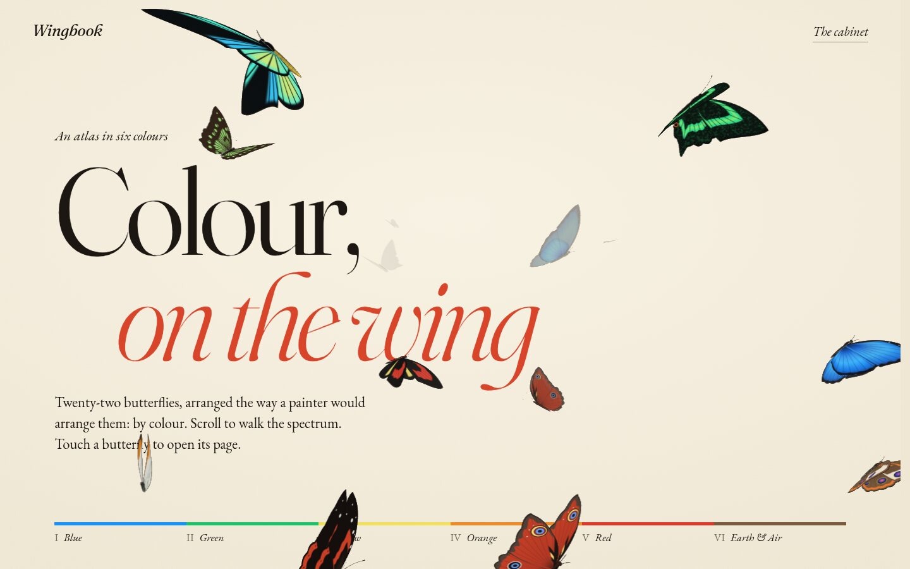
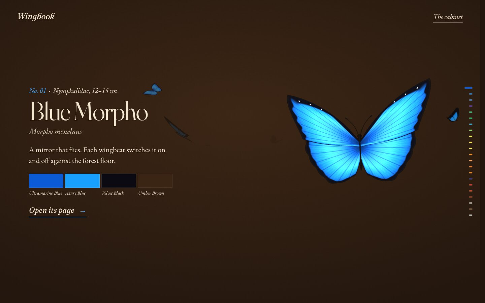
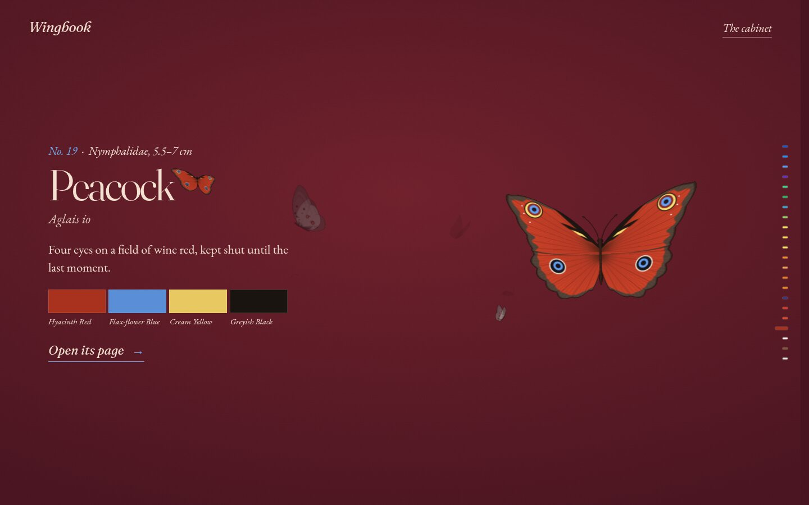
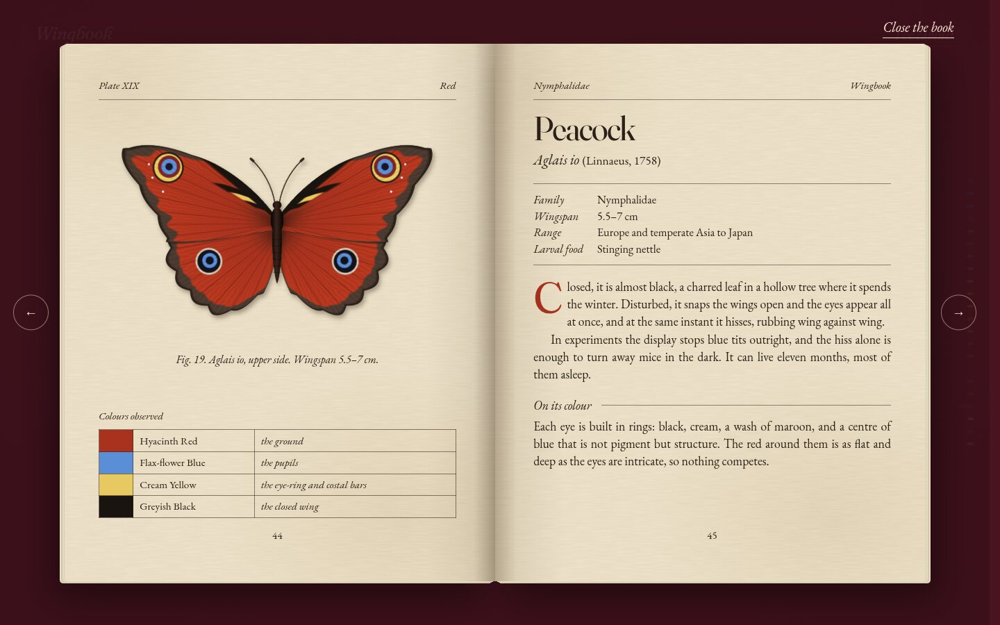
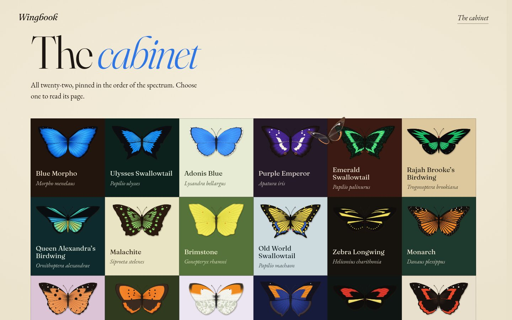
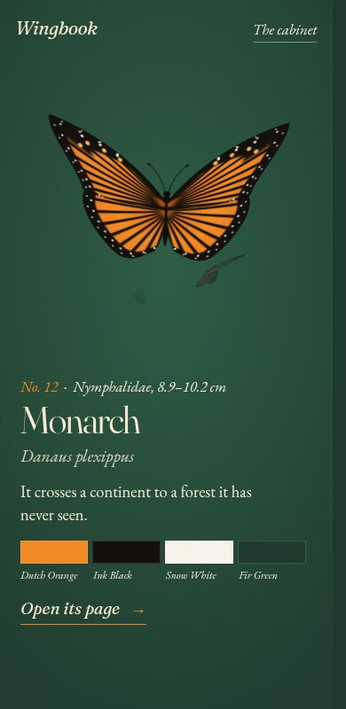

# Wingbook

**Butterflies, arranged by colour.**

### [wingi-pedia.vercel.app](https://wingi-pedia.vercel.app)



Wingbook is a small atlas of twenty-two butterflies. It is ordered the way a painter would order them: by colour, from blue through green, yellow, orange and red to the browns, ending with a butterfly that has no colour at all.

## What it's like

**Scroll, and you fly.** Each butterfly flies in, settles beside its name, and takes off again as you move on. The whole page changes colour with it, taking its shades from where that butterfly lives: the Blue Morpho sits on a dark forest floor, the Monarch on the green of the fir forests it travels to.





**Tap a butterfly and it becomes a book.** It flies onto the page of an old encyclopedia as the book opens around it. Each spread has a drawing of the butterfly, a table of its colours with their old names, and a short account of how it lives and where its colour comes from. Turn the page to reach the next one.



**The cabinet** at the end shows all twenty-two at once, like a collector's drawer.



It works on phones too.



## Good to know

- Twenty of the butterflies are drawn by the site itself, scale by scale, and simplified, so the real insects are more detailed than these. The Blue Morpho and the Glasswing are photographs of real specimens.
- There are around 18,000 kinds of butterfly. This is a first drawer, not the whole collection.
- The colour names follow *Werner's Nomenclature of Colours* (1821), a book of colour names that naturalists, Darwin among them, carried into the field.

## Run it yourself

You'll need [Node.js](https://nodejs.org). Then:

```
npm install
npm run dev
```

and open the address it prints.
